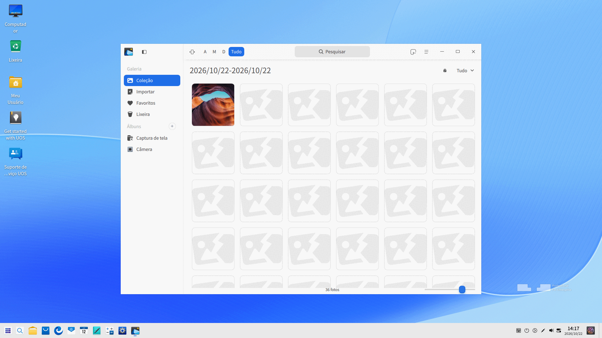
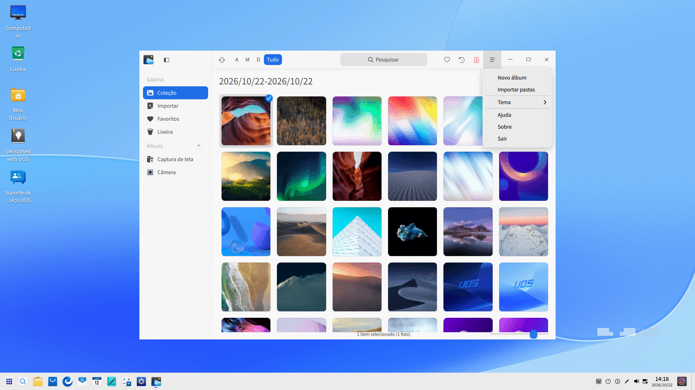
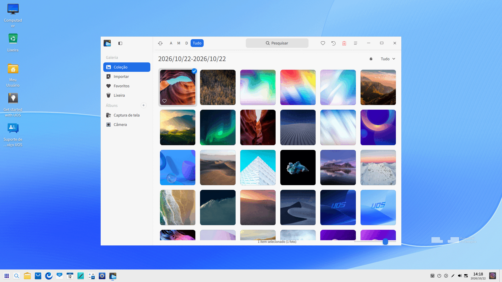
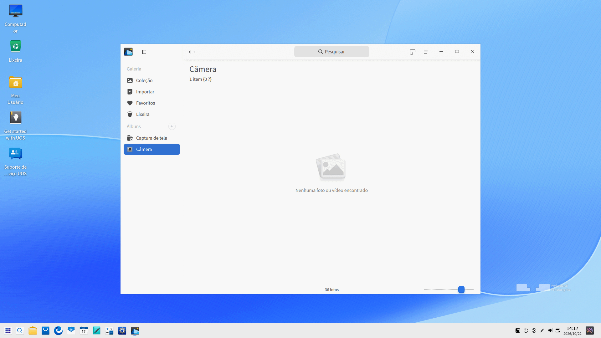
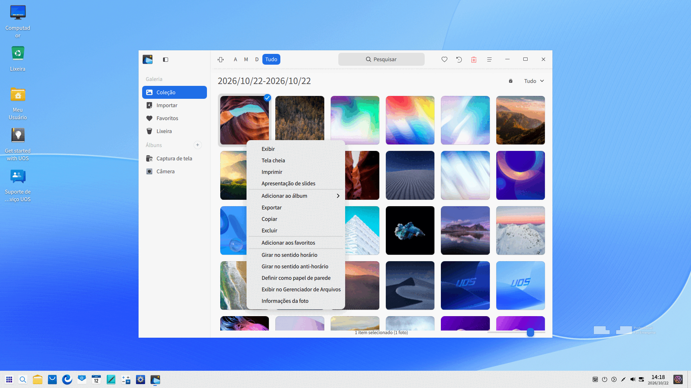

# Álbum|deepin-album|

## Visão Geral

O Álbum é uma ferramenta elegante e fluida para gerenciamento de fotos e vídeos, com suporte para visualização e organização de fotos e vídeos em diversos formatos. Você pode organizar suas fotos e vídeos por data ou linha do tempo, adicioná-los aos Favoritos ou categorizá-los em diferentes álbuns para manter tudo em perfeita ordem.

## Guia

Você pode executar, fechar e criar um atalho na área de trabalho para o Álbum das seguintes maneiras:

### Executar o Álbum

1. Clique no ícone do Iniciador  no Dock para abrir a interface do Iniciador.
2. Localize o Álbum  rolando a roda do mouse ou pesquisando por "álbum" no Iniciador e clique nele para executar.
3. Clique com o botão direito em  para:
 - Clicar em **Enviar para a área de trabalho** para criar um atalho na área de trabalho.
 - Clicar em **Fixar no dock** para fixar o aplicativo no Dock.
 - Clicar em **Adicionar à inicialização** para que o aplicativo seja executado automaticamente ao iniciar o sistema.

>  Dicas: No Centro de Controle, você pode definir o Álbum como o aplicativo padrão para visualização de fotos. Consulte [Aplicativos Padrão](dman:///dde#Default Applications) para operações específicas.

### Sair do Álbum

- Na interface do Álbum, clique em  para sair.
- Clique com o botão direito em  no Dock e selecione **Fechar tudo** para sair.
- Na interface do Álbum, clique em  e selecione **Sair** para fechar o aplicativo.

### Exibir Atalhos

Na interface do Álbum, pressione **Ctrl** + **Shift** + **?** para visualizar os atalhos. O domínio dos atalhos aumentará significativamente a sua eficiência.

## Gerenciamento de Fotos e Vídeos

Você pode gerenciar fotos e vídeos por **Linhas do Tempo** e **Álbuns** após iniciar o aplicativo.

### Importar Fotos e Vídeos

Na interface do Álbum, você pode importar fotos e vídeos da seguinte forma:
- Clique em **Importar Fotos e Vídeos** quando não houver fotos ou vídeos no álbum.
- Clique no ícone  na barra de título.
- Arraste arquivos de fotos e vídeos diretamente para a interface do Álbum.
- Clique em ** > Importar pastas** para importar pastas personalizadas de fotos ou vídeos.
- Importe fotos e vídeos a partir de um dispositivo móvel conectado.

### Pesquisar Fotos e Vídeos

1. Na caixa de pesquisa no topo da interface do Álbum, clique em  para digitar palavras-chave.
2. Pressione a tecla **Enter** no teclado para localizar rapidamente as fotos ou vídeos.

### Visualizar Fotos e Vídeos

Ajuste a barra deslizante na interface do Álbum para alterar o tamanho das miniaturas de fotos e vídeos.

Clique em **Todos** no canto superior direito para ver todas as fotos e vídeos. Clique em **Fotos** para visualizar apenas fotos. Clique em **Vídeos** para visualizar apenas vídeos.

Dê um clique duplo em uma foto, ou clique com o botão direito e selecione **Visualizar** para entrar na interface de visualização de fotos. Pressione **Esc** no teclado para sair. Dê um clique duplo em um vídeo, ou clique com o botão direito e selecione **Visualizar** para abrir o reprodutor de vídeo e reproduzi-lo.

| Ícone | Nome | Descrição |
| ------------------------------------------------------- | ----------------------- | ------------------------------------------------------------ |
|  | Voltar | Retorna à interface principal. |
|  | Anterior | Alterna para a foto anterior. |
|  | Próxima | Alterna para a próxima imagem. |
|  | Tamanho 1:1 | Exibe a foto em tamanho 1:1 sem alterar o tamanho da janela. |
|  | Ajustar à janela | Redimensiona a foto para se ajustar à janela atual. |
|  | Girar no sentido horário | Gira a foto 90 graus no sentido horário. |
|  | Favoritar | Adiciona a foto aos seus Favoritos. |
|  | Extrair texto | Reconhece textos na imagem (OCR). |
|  | Girar no sentido anti-horário | Gira a foto 90 graus no sentido anti-horário. |
|  | Excluir | Exclui a foto atual. |

&nbsp;&nbsp;&nbsp;&nbsp;&nbsp;&nbsp;&nbsp;&nbsp;&nbsp;&nbsp;&nbsp;&nbsp;&nbsp;
>  Dicas: Role a roda do mouse para ampliar a imagem. Se a imagem ampliada ultrapassar os limites da janela, uma janela de navegação aparecerá na parte inferior. Arraste o retângulo na janela para posicionar rapidamente a área desejada da foto. Você pode clicar em  no canto superior direito da janela de navegação para fechá-la. Ao clicar com o botão direito na foto, você pode selecionar **Ocultar janela de navegação/Mostrar janela de navegação**.

### Visualizar por Data

Na visualização por data, todas as fotos e vídeos são agrupados e exibidos de acordo com o momento da captura da foto ou da gravação do vídeo. Arquivos de datas diferentes são organizados em grupos, permitindo encontrar facilmente arquivos de um dia específico.

### Imprimir Fotos

1. Na interface do Álbum, selecione a foto a ser impressa e clique com o botão direito selecionando **Imprimir**.
2. Selecione a impressora e defina os parâmetros de impressão.
3. Clique em **Imprimir**.

### Extrair Textos

1. Dê um clique duplo na foto para entrar na interface do Visualizador de Imagens.
2. Clique em  na barra de ferramentas ou clique com o botão direito na foto e selecione **Extrair texto** para abrir a interface de extração de texto e reconhecer os caracteres na imagem.
3. Você pode editar, copiar e salvar os textos reconhecidos como TXT, etc.

### Apresentação de Slides

1. Na interface do Álbum, clique com o botão direito em uma foto.
2. Selecione **Apresentação de slides** para exibir a foto como slides em tela cheia.
3. Clique com o botão direito para selecionar **Sair** ou pressione **Esc** no teclado para sair.

### Copiar Fotos e Vídeos

1. Na interface do Álbum, clique com o botão direito em uma foto ou vídeo.
2. Selecione **Copiar**.
3. Clique com o botão direito na área de trabalho ou em uma pasta de destino e selecione **Colar** para copiar o arquivo.

### Favoritar Fotos e Vídeos

1. Na interface do Álbum, clique com o botão direito em uma foto ou vídeo.
2. Selecione **Favoritar** e a foto ou vídeo será adicionado ao álbum **Favoritos**.
3. Clique com o botão direito na foto ou vídeo em Favoritos para **Desfavoritar**.

>  Dicas: Você também pode clicar em **Selecionar** no canto superior direito para marcar várias fotos ou vídeos e clicar no ícone  para favoritá-los em lote, e clicar em  novamente para desfavoritá-los.

### Girar Fotos

1. Na interface do Álbum, clique com o botão direito em uma foto e selecione **Girar no sentido horário** ou **Girar no sentido anti-horário**.
2. A foto será girada 90 graus na direção escolhida.

>     Dicas: Você também pode clicar em **Selecionar** no canto superior direito para marcar várias fotos e clicar em  ou  na interface para girar as fotos em lote.

### Definir como Papel de Parede

1. Clique com o botão direito na foto na interface do Álbum.
2. Selecione **Definir como papel de parede** para configurar a foto atual como plano de fundo da área de trabalho.

### Exibir no Gerenciador de Arquivos

1. Clique com o botão direito na foto ou vídeo na interface do Álbum.
2. Selecione **Exibir no gerenciador de arquivos** para abrir a pasta onde o arquivo está gravado.

### Exibir Informações da Foto e do Vídeo

1. Clique com o botão direito na foto ou vídeo na interface do Álbum.
2. Selecione **Informações da foto** ou **Informações do vídeo** para visualizar detalhes completos do arquivo.

### Excluir Fotos e Vídeos

Você pode excluir fotos e vídeos do Álbum das seguintes maneiras:

- Clique no ícone  na barra inferior ao visualizar fotos.
- Na interface do Álbum, clique em **Selecionar** no canto superior direito para selecionar fotos ou vídeos e clique em .
- Clique com o botão direito na foto ou vídeo e selecione **Excluir**.
- Selecione a foto ou vídeo e pressione a tecla **Delete** no teclado.

>  Dicas: As fotos e vídeos excluídos no Álbum não são apagados permanentemente de imediato, ficando temporariamente armazenados no álbum **Lixeira**. Quando a contagem regressiva exibida na foto atingir 0, o arquivo será excluído em definitivo. Você pode restaurar ou excluir definitivamente fotos e vídeos da Lixeira a qualquer momento antes desse prazo.

## Gerenciamento de Álbuns

Na interface do Álbum, você pode criar novos álbuns, gerenciar fotos e vídeos nos álbuns e visualizar todos os álbuns existentes.

As pastas Capturas de tela, Câmera e Desenho dentro do diretório Imagens/Vídeos no Gerenciador de Arquivos serão importadas para o Álbum automaticamente e exibidas no painel esquerdo com os nomes correspondentes.

### Criar Novos Álbuns

1. Na interface de Álbuns, clique em  ou em  > **Novo álbum**.
2. Digite o nome do álbum e clique em **Criar**.

>  Dicas: Você pode criar um novo álbum clicando com o botão direito em um álbum personalizado e selecionando **Novo álbum**, ou clicando com o botão direito em fotos ou vídeos selecionados e escolhendo **Adicionar ao álbum**.

### Adicionar Fotos e Vídeos a Álbuns

1. Na interface do Álbum, clique com o botão direito em uma foto ou vídeo e selecione **Adicionar ao álbum**.
2. Selecione o álbum desejado para adicionar a foto ou vídeo.

> Dicas: Você também pode arrastar fotos ou vídeos diretamente para um álbum personalizado no painel esquerdo.

### Remover Fotos e Vídeos de Álbuns

1. Na interface de Álbuns, clique com o botão direito em uma foto ou vídeo dentro de um álbum personalizado.
2. Selecione **Remover do álbum** para retirar a foto ou vídeo daquele álbum.

### Renomear Álbuns

1. Na interface de Álbuns, clique com o botão direito no álbum personalizado a ser renomeado e selecione **Renomear**.
2. Digite o novo nome e pressione a tecla **Enter** no teclado ou clique em uma área vazia da interface.

### Exportar Álbuns

1. Na interface de Álbuns, clique com o botão direito em um álbum que contenha apenas fotos.
2. Selecione **Exportar**.
3. Selecione o caminho de destino e clique em **Salvar** na caixa de diálogo.

### Excluir Álbuns

1. Na interface de Álbuns, clique com o botão direito em um álbum personalizado.
2. Selecione **Excluir**.
3. Clique em **Excluir** na caixa de diálogo de confirmação.

>  Notas: Esta ação apenas remove o álbum do aplicativo e não exclui os arquivos originais armazenados no seu dispositivo local.

## Menu Principal

No menu principal, você pode [Criar Novos Álbuns](#criar-novos-álbuns), alternar temas de janela, visualizar o manual de ajuda e obter mais informações sobre o Álbum.

### Tema

A janela oferece três opções de tema: Tema Claro, Tema Escuro e Tema do Sistema.

1. Clique em  na interface do Álbum.
2. Clique em **Tema** para escolher uma opção.

### Ajuda

1. Clique em  na interface do Álbum.
2. Clique em **Ajuda** para visualizar o manual do Álbum.

### Comentários

1. Clique em  na interface do Álbum.
2. Clique em **Comentários** e uma janela de autenticação será exibida.
3. Insira sua senha para enviar seus comentários e sugestões no fórum do deepin.

### Sobre

1. Clique em  na interface do Álbum.
2. Clique em **Sobre** para visualizar a versão e a apresentação do Álbum.

### Sair

1. Clique em  na interface do Álbum.
2. Clique em **Sair** para fechar o Álbum.
